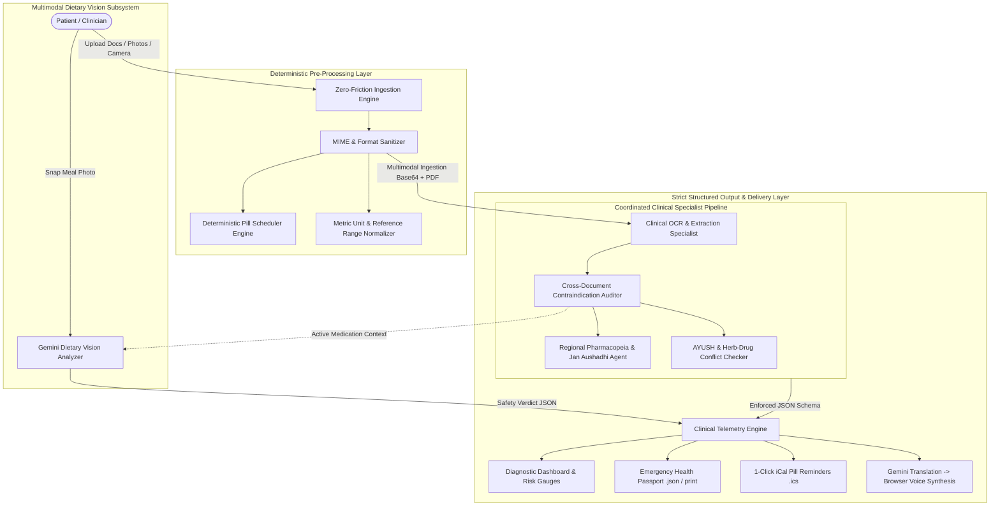

<div align="center">


# CuraScan Health
### Real-Time Multimodal Clinical Forensics & Prescription Safety Auditor

[](https://react.dev)
[](https://vitejs.dev)
[](https://aistudio.google.com/)
[](https://www.npmjs.com/package/@google/genai)
[](https://tailwindcss.com/)
[](LICENSE)

**Intercepting fatal medical contraindications before they reach the patient.**  
Cross-Document Multimodal Reasoning · Deterministic Heuristics · Regional Drug Alternatives (Jan Aushadhi) · Multimodal Meal Safety · Multilingual Audio Forensics

Built with ❤️ by **Team Infinex** for the **Build with Gemini Hackathon** - *Best Use of Google Gemini API* 🏆

</div>

---

## 📑 Table of Contents
- [Executive Overview](#-executive-overview)
- [System Architecture & Multi-Agent Flow](#-system-architecture--multi-agent-flow)
- [How CuraScan Excels Across Evaluation Criteria](#-how-curascan-excels-across-evaluation-criteria)
  - [1. Use of Google Gemini](#1-use-of-google-gemini)
  - [2. Innovation & Idea](#2-innovation--idea)
  - [3. Impact & Real-World Usefulness](#3-impact--real-world-usefulness)
- [Core Functional Modules](#-core-functional-modules)
- [Strict JSON Telemetry Schemas](#-strict-json-telemetry-schemas)
- [Security, Privacy & Key Architecture](#-security-privacy--key-architecture)
- [Getting Started & Local Setup](#-getting-started--local-setup)
- [License & Verification](#-license--verification)

---

## 🩺 Executive Overview

In medical ecosystems worldwide, **Adverse Drug Events (ADEs)** and undetected contraindications represent one of the leading causes of preventable hospitalizations and mortality. The danger peaks when patients receive prescriptions from different doctors who lack access to recent diagnostic lab tests, or when patients take medications alongside conflicting dietary items or traditional herbal therapies.

**CuraScan Health** transforms healthcare safety by acting as an omnipresent **Clinical Pharmacologist & Diagnostic Auditor**. Rather than using a generic chatbot, CuraScan pairs **high-speed deterministic heuristics** with **multimodal Google Gemini 2.5 / 2.0 Flash reasoning** to parse handwritten prescriptions, cross-examine complex laboratory panels, inspect meal photos for biochemical contraindications, and export lifesaving medical passports.

---

## 📸 System Architecture & Multi-Agent Flow



---

## 🏆 How CuraScan Excels Across Evaluation Criteria

### 1. Use of Google Gemini

| Evaluation Dimension | Implementation Evidence in CuraScan |
| :--- | :--- |
| **Official SDKs** | Uses `@google/genai` (v2.16.0) and `@google/generative-ai` (v0.24.1) directly integrated in `package.json` and `src/services/geminiService.js`. |
| **Model Selection & Redundancy** | Primary engine: `gemini-2.5-flash` for high-speed multimodal reasoning; intelligent auto-fallback circuit breaker to `gemini-2.0-flash` ensuring zero downtime if rate limits or network degradation occur. |
| **Beyond Basic Prompt Wrapping** | Executes a specialized **Coordinated Clinical Specialist Pipeline**: (1) Clinical OCR Extraction Specialist, (2) Pharmacological Contraindication Auditor, (3) Dietary Vision Analyzer, (4) Stateful Clinical Diagnostic Copilot, and (5) Multilingual Audio Localization Agent. |
| **Massive Multimodal Context** | Simultaneously ingests disparate files (e.g. a crumpled handwritten prescription JPG alongside a multi-page PDF blood panel) in a single unified prompt context window, performing multi-document cross-correlation. |
| **Strict JSON Telemetry Enforcement** | Enforces native `responseMimeType: 'application/json'` with rigorous schema constraints, guaranteeing deterministically parseable JSON payloads without markdown leakage or hallucinated field names. |
| **Vision Analysis** | Analyzes live food images to identify biochemical compounds (e.g. Vitamin K in leafy greens, tyramine in aged cheeses, statin inhibitors in grapefruit) and cross-references them against active prescriptions. |

---

### 2. Innovation & Idea

* **Hybrid Deterministic Heuristics + Deep Multimodal AI**:  
  Pure LLMs can hallucinate dates or mathematical ranges, while static rules cannot decipher handwritten prescriptions or clinical nuances. CuraScan fuses the two: deterministic local scheduling algorithms compute precise medication timetables (`.ics`), while Gemini performs high-dimensional pharmacological reasoning.
* **Cross-Document Contraindication Engine**:  
  Existing medical apps evaluate a single document in isolation. CuraScan evaluates the **intersection** of multiple documents (e.g. Doctor A prescribes Metformin, but Lab B indicates an eGFR of 32 mL/min → CuraScan raises a **CRITICAL DANGER: Lactic Acidosis Risk** contraindication).
* **Culturally & Regionally Grounded Clinical Forensics**:  
  Standard Western AI tools fail to consider local therapeutic patterns:
  - **Jan Aushadhi / PMBJP Generic Equivalents**: Recommends generic alternatives from the Indian Government's Pradhan Mantri Bhartiya Janaushadhi Pariyojana, cutting patient medication expenses by 60%–90%.
  - **AYUSH Herb-Drug Cross-Checks**: Analyzes potential adverse interactions between allopathic pharmaceuticals and traditional herbs (e.g. Ashwagandha, Giloy, Karela extract, Turmeric/Curcumin).
  - **Region-Specific Lab Ranges**: Accounts for localized clinical benchmarks (such as tighter Asian/Indian BMI cutoffs and tailored HbA1c diabetic thresholds).

---

### 3. Impact & Real-World Usefulness

* **Directly Tackling the Adoption Barrier**:  
  *Critique Addressed*: *"Non-technical, vulnerable patients will not copy-paste complex text into a web form."*  
  *CuraScan Solution*: **Zero-Friction Ingestion**. Users take a photo with their phone camera or drop a raw scan. The system requires zero manual typing or transcription.
* **Universal Accessibility for At-Risk Populations**:  
  - **Dyslexia-friendly typography toggle** (OpenDyslexic font engine).
  - **High-contrast mode** and reduced-motion settings for visually and neurologically sensitive patients.
  - **On-The-Fly Audio Translation**: Gemini translates findings into regional languages (Hindi, Tamil, Telugu, Spanish, French) on-demand, which are narrated aloud through native text-to-speech for elderly or low-literacy users.
* **Actionable Emergency Readiness**:  
  - **Portable Emergency Health Passport**: Downloads a portable JSON document and one-click printable medical summary containing verified drug lists, allergies, and critical alerts for emergency responders.
  - **Native Device Calendar Sync**: Generates RFC 5545 compliant `.ics` calendar files with automated reminder alarms (Morning 8 AM, Lunch 1 PM, Evening 6 PM, Bedtime 10 PM) synced straight to Google Calendar and Apple Calendar.

---

## ⚡ Core Functional Modules

| Module | Technical Capability | Real-World Clinical Value |
| :--- | :--- | :--- |
| 📋 **Multimodal Clinical OCR** | Deciphers illegible doctor handwriting, abbreviations (OD, BD, TID, QID, HS), and structured lab tables. | Eliminates dosage misunderstandings and transcription errors. |
| ⚠️ **Cross-Document Auditor** | Correlates blood chemistry, kidney/liver panels, and current medications. | Detects silent contraindications (e.g. NSAIDs + renal impairment, ACE inhibitors + hyperkalemia). |
| 🥗 **Meal Safety Scanner** | Vision-based analysis of meal photos against active medications and metabolic lab values. | Prevents dangerous dietary interactions (e.g. Warfarin + Vitamin K, Statins + Grapefruit). |
| 🇮🇳 **Jan Aushadhi Scheme Matcher** | Scans prescribed branded drugs against the Indian PMBJP generic formulary. | Empowers low-income families to access life-saving drugs at a fraction of brand-name costs. |
| 🌿 **AYUSH Conflict Engine** | Cross-references Ayurvedic, Homeopathic, and herbal regimens with Western allopathy. | Uncovers overlooked herbal-allopathic drug conflicts before liver or kidney toxicity occurs. |
| 📅 **Automated Medication Scheduler** | Produces `.ics` iCalendar files with pre-configured alarm notifications based on frequency. | Drives medication compliance and prevents missed or double doses. |
| 💬 **Stateful Follow-Up Copilot** | Contextual conversation engine maintaining the patient's full clinical audit state. | Provides patient reassurance, clarifies side effects, and suggests tailored follow-up queries. |

---

## 🗄️ Strict JSON Telemetry Schemas

All Gemini diagnostic outputs adhere to strictly enforced JSON structures for deterministic client-side rendering:

```json
{
  "patientName": "Sunita Sharma",
  "documentDate": "2026-11-15",
  "overallSafetyScore": 68,
  "safetyLevel": "critical",
  "crossDocumentAlerts": [
    {
      "severity": "CRITICAL DANGER",
      "issue": "Glimepiride 2mg prescribed while fasting blood glucose is already at 74 mg/dL.",
      "mechanism": "High risk of acute hypoglycemic shock; dosage must be re-evaluated against lab profile.",
      "clinicalAction": "Withhold next dose until primary physician reviews current lab metrics."
    }
  ],
  "medications": [
    {
      "name": "Metformin",
      "dosage": "500 mg",
      "timing": "After food",
      "frequency": "BD",
      "genericAlternative": "Metformin Hydrochloride 500mg (Jan Aushadhi)",
      "estimatedCostINR": "₹12 for 10 tablets (vs ₹65 branded)"
    }
  ],
  "ayushInteractions": [
    {
      "herb": "Karela (Bitter Gourd) Juice",
      "conflict": "Additive hypoglycemic effect with oral anti-diabetic agents.",
      "severity": "Moderate"
    }
  ]
}
```

---

## 🔒 Security, Privacy & Key Architecture

- **Client-Side Data Isolation**: Medical documents and images are parsed in-memory as Base64 blobs; sensitive medical data is never retained on third-party tracking databases.
- **Secure Key Handling**: Gemini API communication is managed via environment variables (`VITE_GEMINI_API_KEY`). If unconfigured in the environment, an encrypted in-memory session input allows users to test with their own Google AI Studio key without persistent storage.
- **Strict Ephemeral Execution**: Calendar exports and Health Passports generate client-side `Blob` URLs downloaded straight to the user's local filesystem.

---

## 🚀 Getting Started & Local Setup

### 1. Prerequisites
- Node.js (v18.0.0 or higher)
- npm or yarn
- A Google Gemini API Key from [Google AI Studio](https://aistudio.google.com/)

### 2. Clone the Repository
```bash
git clone https://github.com/immanuel-thomas-j/MediPulse-Health.git
cd MediPulse-Health
```

### 3. Install Dependencies
```bash
npm install
```

### 4. Configure Environment Variables
Create a `.env` file in the project root:
```env
VITE_GEMINI_API_KEY=your_gemini_api_key_here
```
*(Optional: If not provided in `.env`, you can paste your key in the dashboard settings modal at runtime).*

### 5. Launch the Development Server
```bash
npm run dev
```
Navigate to `http://localhost:5173` in your browser.

### 6. Production Build
```bash
npm run build
npm run preview
```

---

## 📄 License & Verification

Distributed under the **MIT License**. See `LICENSE` for details.

<div align="center">
  <sub>Built with ❤️ by <strong>Team Infinex</strong> for the <strong>Build with Gemini Hackathon</strong></sub>
</div>
